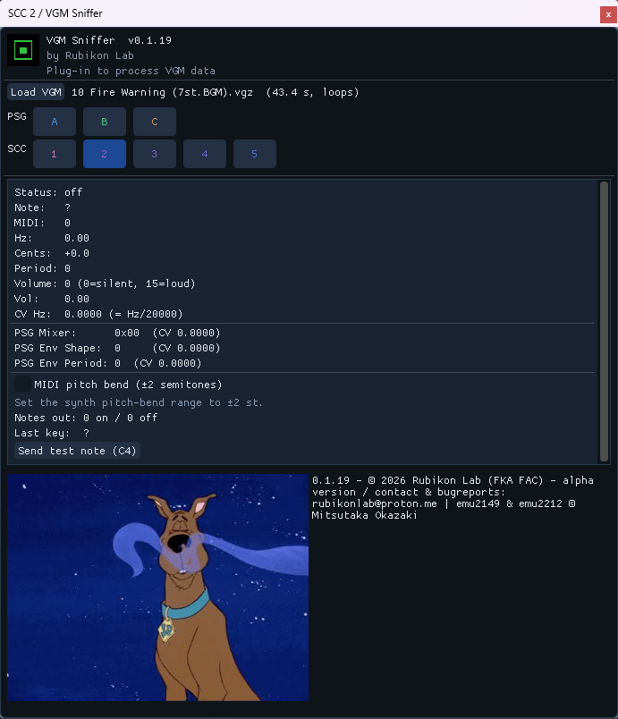

# VGM Sniffer

**VGM Sniffer** is a Windows CLAP instrument from [Rubikon Lab](https://rubikonlab.nl). It plays a `.vgm` or `.vgz` file in time with the host and exposes **one** MSX chip voice — SCC 1–5 or PSG A/B/C — as audio, control voltage, and notes. Use it in Bitwig (or another CLAP host) to pull a single part out of a VGM and drive The Grid, another synth, or a sampler.

Current release: **0.1.19** (alpha). Contact and bug reports: rubikonlab@proton.me



It is not a full mixer. Load a file, pick one channel, and route that voice’s outs. A longer description of each port is in [docs/VGM-Sniffer-manual.md](docs/VGM-Sniffer-manual.md).

## What the host receives

| Port | Kind | Use |
|------|------|-----|
| Main | Stereo audio | The selected voice |
| CV Hz | Mono CV | Pitch as Hz / 20000 |
| CV Vol | Mono CV | Voice level, 0…1 |
| Wave | Mono audio | The voice shape, level-normalized |
| PSG CV Noise | Mono CV | PSG noise pitch as Hz / 20000 |
| PSG Tone | Mono audio | PSG square wave only |
| PSG Noise | Mono audio | PSG noise only |
| PSG Mixer | Mono CV | Song mixer `(R7 & 0x3F) / 63` |
| PSG Env Shape | Mono CV | Envelope shape `R13 / 15` |
| PSG Env Period | Mono CV | Envelope period `(R11 + R12<<8) / 65535` |
| SCC Pitch | Note | MIDI / CLAP notes from the selected voice |

Playback follows the host timeline and wraps at the VGM loop point. Chip audio is generated at **44100 Hz**; use that project sample rate.

## Install the CLAP

Windows, Visual Studio 2022 (MSVC), and CMake 3.17 or newer.

```bat
git clone --recurse-submodules https://github.com/hrubix/VGMSniffer.git
cd VGMSniffer
cmake -B build -G "Visual Studio 17 2022" -A x64
cmake --build build --config Release --target scc-vgm
```

The Release build copies `scc-vgm.clap` to:

`%LOCALAPPDATA%\Programs\Common\CLAP\scc-vgm.clap`

Rescan plug-ins in Bitwig, then add **VGM Sniffer**.

If Bitwig already has the plug-in loaded, the file is locked and the build writes `scc-vgm-new.clap` in that same folder instead. Quit Bitwig, rename `scc-vgm-new.clap` to `scc-vgm.clap`, and start Bitwig again. After a build that changes the output list, remove the device and add it again so Bitwig picks up the new ports.

To install a build you already have:

```powershell
powershell -File scripts/install-scc-vgm.ps1 -ClapPath build\Release\scc-vgm.clap -DestDir "$env:LOCALAPPDATA\Programs\Common\CLAP"
```

## Credits

emu2149 and emu2212 © Mitsutaka Okazaki. Dear ImGui, CLAP, readerwriterqueue, and miniz are included as submodules or vendored sources under their own licenses.
